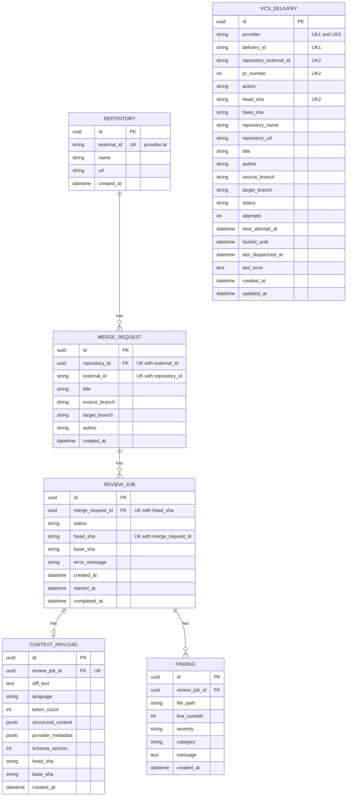

# Entity-Relationship Diagram

`VCS_DELIVERY` is an inbox table and has no foreign keys: it identifies the pull request by the provider-native `repository_external_id` and `pr_number`. Ingestion links a delivery to the relational model only logically, by upserting the `REPOSITORY` (`external_id` = `<provider>:<repository_external_id>`), `MERGE_REQUEST` and `REVIEW_JOB` rows.

Unique constraints (migration `a3c1e5d97b42`):

| Table | Constraint | Columns |
|---|---|---|
| `vcs_deliveries` | `uq_vcs_deliveries_provider_delivery` (UK1) | `provider`, `delivery_id` |
| `vcs_deliveries` | `uq_vcs_deliveries_revision` (UK2) | `provider`, `repository_external_id`, `pr_number`, `head_sha` |
| `merge_requests` | `uq_merge_requests_repository_external_id` | `repository_id`, `external_id` |
| `review_jobs` | `uq_review_jobs_merge_request_head` | `merge_request_id`, `head_sha` |

`vcs_deliveries` also has the index `ix_vcs_deliveries_status_next_attempt_at` on `(status, next_attempt_at)`. `repositories.external_id` and `context_payloads.review_job_id` are unique from the initial schema (the second makes `REVIEW_JOB` to `CONTEXT_PAYLOAD` one-to-one).
